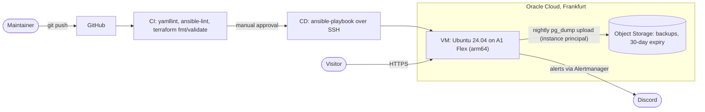

# site-analytics-iac

Infrastructure as code for a self-hosted web analytics service ([Umami](https://umami.is)) on Oracle Cloud's Always Free tier. One `terraform apply` and one `ansible-playbook` turn an empty cloud account into a hardened, monitored, backed-up HTTPS service. Every configuration change after that goes through a CI/CD pipeline with a manual approval gate. Terraform is validated in CI but applied by hand, because it needs cloud credentials that never leave the maintainer's machine.

The application stack (Umami + PostgreSQL + Caddy) lives in a separate repository, [`site-analytics`](https://github.com/panoskola/site-analytics). This repository provisions and operates everything around it.

## Architecture



On the VM, two Docker Compose projects run side by side:

- **site-analytics**: Umami, PostgreSQL 16, Caddy 2 (automatic Let's Encrypt certificates).
- **monitoring**: Prometheus, Alertmanager, blackbox exporter, node exporter. Bound to localhost only; reached through an SSH tunnel.

## What is in the repository

| Path | Purpose |
|------|---------|
| `terraform/` | VCN, subnet, security list, A1 VM, Object Storage bucket with lifecycle rule, dynamic group and IAM policies; remote state in a separate, versioned Object Storage bucket (`backend.tf`) |
| `ansible/site.yml` | Single play applying the roles below |
| `ansible/roles/base` | Packages, timezone, CI/CD deploy key |
| `ansible/roles/docker` | Docker Engine and Compose plugin from the official apt repository |
| `ansible/roles/firewall` | Host iptables rules, persisted across reboots |
| `ansible/roles/hardening` | SSH hardening (keys only, no root), fail2ban |
| `ansible/roles/app` | Clones the application repo, renders `.env` from Vault secrets, starts the stack, cron jobs |
| `ansible/roles/monitoring` | Prometheus stack, alert rules, Discord notifications |
| `ansible/roles/backup` | Upload of nightly dumps to Object Storage, weekly automated restore test |
| `.github/workflows/ci.yml` | Lint, validate, and deploy with approval |

## Security decisions

- **Secrets never touch the repository.** Application secrets and the Discord webhook are in Ansible Vault (`ansible/group_vars/web/vault.yml`, AES256). Terraform variables stay local and are git-ignored; only `terraform.tfvars.example` and `backend.hcl.example` are committed. Terraform state lives in a private, versioned Object Storage bucket, never in git.
- **No cloud credentials on the server.** The VM authenticates to Object Storage as itself (OCI instance principal via a dynamic group). The policy only allows reading and writing objects in the single backup bucket.
- **Dedicated deploy key.** GitHub Actions uses its own SSH key, separate from the maintainer's, so it can be revoked without side effects.
- **Approval gate.** Deployments run in a GitHub environment (`production`) with a required reviewer. The SSH key, host address and vault password are environment secrets, available only to jobs that pass the gate and only on `main`.
- **Pinned SSH host key.** The deploy job writes the server's host key from the `DEPLOY_HOST_KEY` secret into `known_hosts` instead of scanning it on each run, so a man-in-the-middle cannot be trusted by accident. The key was verified once against the fingerprint printed on the server itself. The host key is public information, so it is a repository secret rather than an environment one.
- **Hardened host.** SSH accepts keys only, root login is disabled, fail2ban is active, and the sshd configuration is validated with `sshd -t` before it is applied.
- **Pinned versions.** Container images, the application version, the CI tools (Ansible, ansible-lint, yamllint), the Terraform provider (`~> 9.10`, plus a committed lock file) and the GitHub Actions (by commit SHA) are pinned; nothing runs on `latest`.

## Pipeline

Every push and pull request runs `yamllint`, `ansible-lint` (production profile) and `terraform fmt -check` plus `terraform validate` (no backend, no credentials). A push to `main` additionally starts a deploy job that waits for approval and then runs the same `ansible-playbook` a maintainer would run by hand. Because all roles are idempotent, a deploy of an unchanged repository reports `changed=0`.

## Monitoring and alerting

Prometheus scrapes the node exporter and probes the public HTTPS endpoint through the blackbox exporter. Alertmanager sends notifications, including resolved ones, to a Discord channel. Rules:

- `SiteDown`: the HTTPS probe fails for 2 minutes
- `CertificateExpiringSoon`: the certificate expires in under 14 days
- `DiskAlmostFull`: under 15% free on `/`
- `MemoryLow`: under 10% memory available
- `TargetDown`: any scrape target is unreachable for 3 minutes

The alert path was tested end to end by stopping the node exporter and observing both the firing and the resolved notification.

To open the Prometheus UI: `ssh -L 9090:localhost:9090 ubuntu@<server>` and browse to `http://localhost:9090`.

## Backups and restore

- 03:15 daily: `pg_dump` of the Umami database to local disk (14 days kept).
- 03:30 daily: the newest dump is uploaded to Object Storage; objects expire after 30 days. A failed upload posts to Discord.
- Sundays 04:30: the newest backup is downloaded, restored into a throwaway PostgreSQL container, sanity-checked, and the result is posted to Discord. A backup that has never been restored is not a backup.

### Disaster recovery runbook

1. `terraform -chdir=terraform init -backend-config=backend.hcl`, then `terraform -chdir=terraform apply` to recreate the network, VM and bucket access. The state survives in its own bucket, so Terraform sees what already exists. (The state bucket is separate from the backup bucket on purpose: the backup bucket expires every object after 30 days.)
2. Regenerate the Ansible inventory from `terraform output` and run `ansible-playbook ansible/site.yml`.
3. Fetch the latest dump on the new server:

   ```bash
   /opt/oci-cli/bin/oci os object list --namespace-name <namespace> --bucket-name site-analytics-backups --auth instance_principal
   /opt/oci-cli/bin/oci os object get  --namespace-name <namespace> --bucket-name site-analytics-backups \
     --name umami/umami-YYYY-MM-DD.sql.gz --file dump.sql.gz --auth instance_principal
   ```

4. Restore into the empty database:

   ```bash
   cd /opt/site-analytics
   gunzip -c dump.sql.gz | docker compose exec -T db psql -U umami umami
   ```

5. Point the DNS name at the new IP (the DuckDNS cron job does this automatically within 30 minutes).

## Quick start

Prerequisites: an OCI account, Terraform, Ansible, an SSH key pair, and an OCI API key.

For remote state, create once by hand (it is deliberately not managed by this configuration): a private Object Storage bucket with versioning enabled, and a Customer Secret Key for your user. Then:

```bash
cp terraform/backend.hcl.example terraform/backend.hcl             # set bucket and namespace
export AWS_ACCESS_KEY_ID=...  AWS_SECRET_ACCESS_KEY=...            # the Customer Secret Key
export AWS_REQUEST_CHECKSUM_CALCULATION=when_required AWS_RESPONSE_CHECKSUM_VALIDATION=when_required
```

```bash
cp terraform/terraform.tfvars.example terraform/terraform.tfvars   # fill in your values
terraform -chdir=terraform init -backend-config=backend.hcl && terraform -chdir=terraform apply

sed "s/203.0.113.10/$(terraform -chdir=terraform output -raw instance_public_ip)/" \
  ansible/inventory.ini.example > ansible/inventory.ini

echo '<vault password>' > ~/.vault_pass && chmod 600 ~/.vault_pass
ansible-vault create ansible/group_vars/web/vault.yml   # vault_postgres_password, vault_app_secret, vault_duckdns_token, vault_discord_webhook
ansible-playbook ansible/site.yml
```

## What broke, and what I learned

- **SSH hardening silently ignored.** On cloud images the provider's `60-cloudimg-settings.conf` is read before my drop-in, and sshd uses the first value it sees. Naming the drop-in `01-hardening.conf` fixed the ordering. Lesson: verify effective configuration with `sshd -T`, not by reading files.
- **Ansible `git` module refused to update.** Making scripts executable on the server created local modifications. The mode belongs in git (`update-index --chmod=+x`), not in a post-clone `chmod`.
- **`changed=1` on every run.** `docker_compose_v2` counts a "Waiting" health-check event as a change. I inspected the module's returned actions and wrote a `changed_when` that only counts real container changes, which restored idempotency and made the deploy report trustworthy.
- **yamllint flagged the GitHub `on:` key** as a truthy value. `on:` is the required key, so the fix was to relax the rule for keys, not rename it.
- **ansible-lint caught a handler with no `changed_when`.** Handlers run only after a real change, so `changed_when: true` is accurate.
- **GitHub rejected a push over a private email address.** Fixed by committing with the noreply address and rewriting the unpushed commits.
- **A new Ubuntu image would have recreated the VM.** The image data source always picks the newest image, and the image ID is part of the instance. The next `apply` after a new release would have destroyed the server. `ignore_changes` on `source_details[0].source_id` pins the VM to the image it was built from.
- **Moving state to Object Storage failed with `AWS chunked encoding not supported`.** OCI's S3-compatible API does not accept the checksum encoding that recent AWS SDKs send. Setting `skip_s3_checksum` in the backend and `AWS_REQUEST_CHECKSUM_CALCULATION=when_required` in the environment fixed it. The failure left the local state untouched, which is why I migrated before deleting anything.
- **A provider constraint that disagreed with the lock file.** I pinned the OCI provider to `~> 6.0` while `.terraform.lock.hcl` held 9.10.0, and `init` refused. `-upgrade` would have silently downgraded the provider, so I changed the constraint to match what the infrastructure was actually built with.
- **Pinning the SSH host key failed on its first run.** Piping the key into `gh secret set` from Windows PowerShell appended a carriage return, `known_hosts` held an invalid key, and the deploy reported `Host key verification failed`. Passing the value with `--body` fixed it. Lesson: when a secret looks right but is rejected, suspect invisible characters.
- **Choosing the monitoring tool.** I dropped Uptime Kuma because its monitors and alerts live in a UI database, which cannot be reviewed or reproduced from the repository. Prometheus and Alertmanager are configured entirely from files.

## Known limitations

- Monitoring runs on the server it watches, so it cannot report a total outage. An external uptime check would cover that.
- Terraform state is in Object Storage (`terraform/backend.tf`), but the state bucket and its Customer Secret Key are created by hand, outside this configuration. There is no state locking, which is fine for a single maintainer but not for a team.
- SSH is reachable from the internet (keys only, fail2ban) so that GitHub-hosted runners can deploy. A self-hosted runner or a bastion would allow restricting it.
- The deploy job trusts the host key in the `DEPLOY_HOST_KEY` secret (the `ssh-ed25519 AAAA...` part of `ssh-keyscan -t ed25519 <host>`). Rebuilding the VM changes the key, so update the secret then.
- The OCI CLI inside the backup role is not version-pinned.

## Notes

Development was assisted by Claude, Anthropic's AI model. Design decisions, testing, deployments and releases are by the maintainer.
